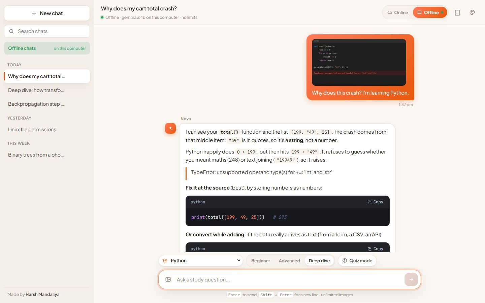
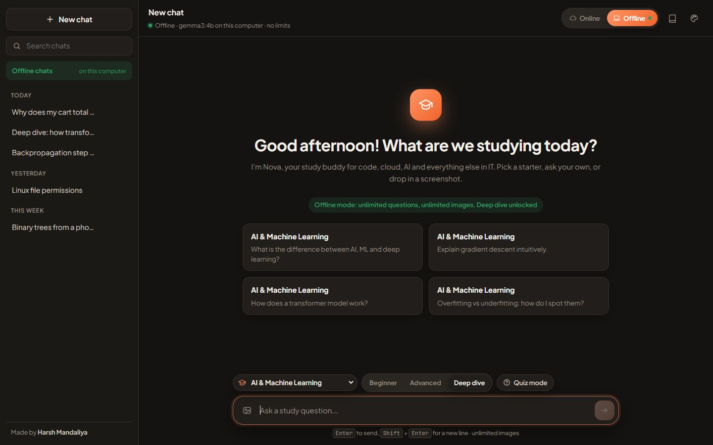
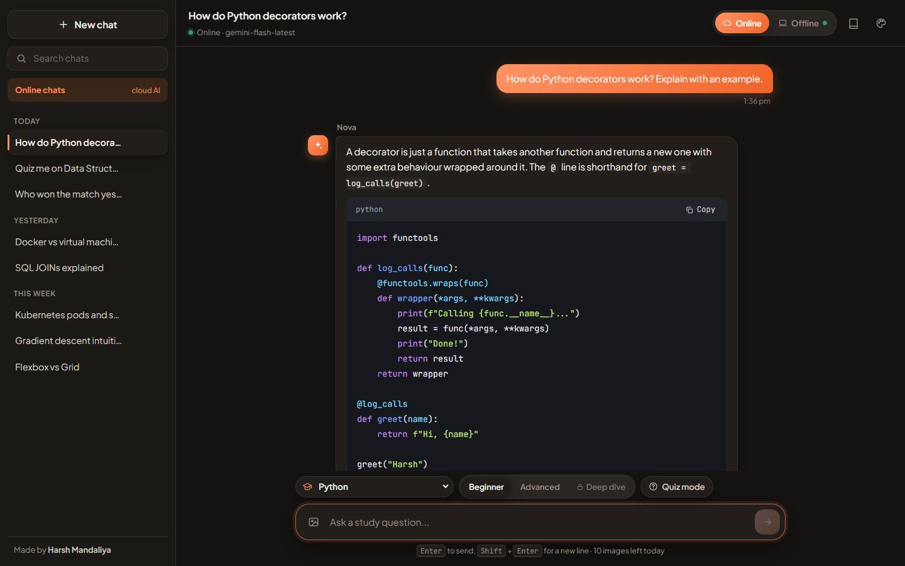
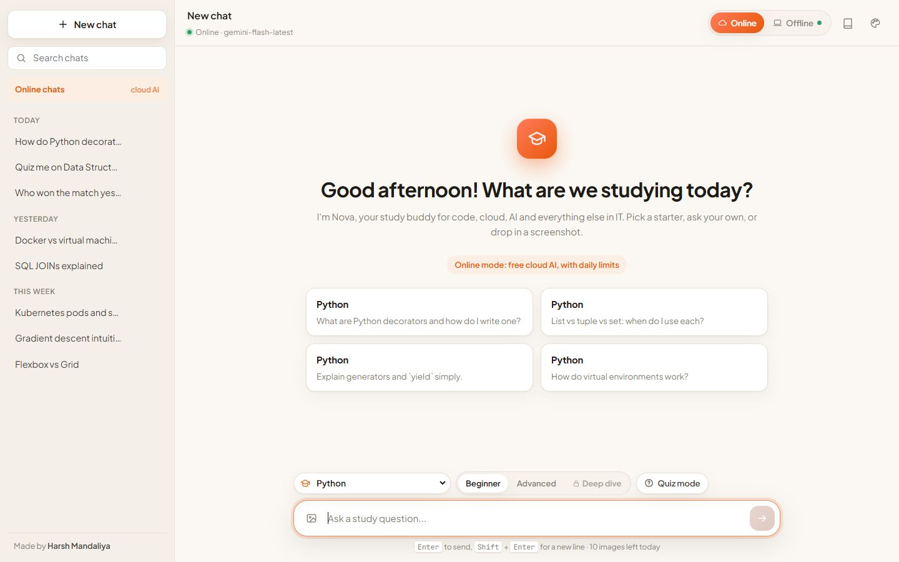

# AI Study Assistant for IT Engineers

A friendly study buddy for IT and engineering students. Ask about programming languages, web development, cloud, DevOps, AI and machine learning, data structures, databases, networking or system design, and get clear explanations with real code examples, streamed in as they're written. Stuck on an error? Drop in a screenshot or a photo of your notes and it will read it and explain.

It runs in two modes:

- **Online**: a free cloud AI (Google Gemini). Needs internet and a free key, and comes with daily limits.
- **Offline**: an AI model running on your own computer through [Ollama](https://ollama.com). No internet, no key and **no limits**: unlimited questions, unlimited screenshots and photos, and the extra **Deep dive** level.

Each mode keeps its **own chat history**. Switch to Online and you only see your online chats; switch to Offline and you only see your offline ones.

The assistant (called **Nova** by default) only does study. Ask it about films or cricket scores and it will kindly steer you back to tech. It talks like a patient senior engineer: warm, direct and to the point, without the stiff "As an AI language model..." tone.

## Screenshots


| | |
|---|---|
|  |  |
| **Offline mode** reading an uploaded screenshot of an error, with its own chat history | **Offline mode** with Deep dive unlocked, Dark theme |
|  |  |
| **Dark theme** with syntax-highlighted code | **Quiz mode** in the Blue theme, with a running score |
|  |  |
| **Multicolor theme** with the Classic (Times New Roman) font | **Theme and font menu**: White, Dark, Blue, Multicolor |
|  |  |
| **Welcome screen** with starter questions for the chosen subject | **Mobile layout** |

## Online vs Offline

| | Online | Offline |
|---|---|---|
| Where the AI runs | Google's servers (free tier) | Your own computer (Ollama) |
| Internet needed | Yes | No |
| API key | Free Gemini key | None |
| Messages | 20 per minute | Unlimited |
| Screenshots and photos | 10 per day | Unlimited |
| Levels | Beginner, Advanced | Beginner, Advanced, **Deep dive** |
| Context it remembers | Last 20 messages | Last 60 messages |
| Quick definitions | Wikipedia | The local model |
| Chat history | Online chats only | Offline chats only |

All the online limits can be changed in `backend/.env`.

## Features

**Study tools**
- **Subject picker** with 11 areas: HTML & CSS, JavaScript & TypeScript, Python, Java/C/C++/Go and more, Data Structures & Algorithms, Databases & SQL, Cloud & DevOps (AWS, Azure, GCP, Docker, Kubernetes), AI & Machine Learning, Networking & Security, System Design, or all topics
- **Beginner / Advanced / Deep dive** levels. Deep dive (Offline) goes all the way: intuition, internals, maths, worked examples, edge cases and interview questions
- **Screenshots and photos**: attach, paste (Ctrl+V) or drag in images of code, errors, diagrams or notes, and ask about them
- **Quiz mode**: multiple-choice questions one at a time, with feedback and a running score
- **Starter questions** for every subject, so you're never staring at a blank box
- **Quick definitions** for any term
- **Syntax-highlighted code blocks** with a one-click copy button
- **Study only**: off-topic questions get a friendly redirect back to tech

**Look and feel**
- Four themes: **White**, **Dark**, **Blue** and **Multicolor**
- Two fonts: **Modern** (sans-serif) and **Classic** (Times New Roman)
- Fonts are bundled with the app, so it looks the same with no internet
- Your mode, theme, font, subject and level are remembered in the browser
- Replies stream in live, with a typing indicator, a stop button and retry on errors
- Separate saved chat history for each mode, grouped by day, with search, rename and delete
- Works well on phones: the sidebar becomes a slide-out drawer

**Backend**
- REST API built with FastAPI, plus a streaming endpoint using server-sent events
- Chats and uploads stored locally (SQLite out of the box, Postgres if you want)
- Uploaded images are checked to be real PNG, JPG, WebP or GIF files
- Validation on every request, with clear error messages in one consistent shape
- Rate limiting and a daily image cap for Online mode, none for Offline
- A demo mode that runs without any key, handy for trying the UI
- Secrets live in `.env`, which is never committed

## Tech stack

| Part      | Tools |
|-----------|-------|
| Frontend  | React 19, TypeScript, Vite, Framer Motion, react-markdown, highlight.js |
| Backend   | Python, FastAPI, SQLAlchemy, Pydantic, OpenAI Python SDK, httpx |
| Database  | SQLite (default) or PostgreSQL |
| Online AI | Google Gemini free tier (Groq also works) |
| Offline AI | Ollama with Gemma 3 4B (understands text and images) |
| Extras    | Wikipedia REST API for quick definitions |

## Free APIs and tools used

| Service | What it's for | Cost | Key |
|---------|---------------|------|-----|
| [Google Gemini](https://aistudio.google.com/app/apikey) | Online mode answers and image reading | Free tier | Yes, free |
| [Ollama](https://ollama.com) + [Gemma 3](https://ollama.com/library/gemma3) | Offline mode, on your computer | Free, open model | No |
| [Groq](https://console.groq.com/keys) | Alternative online provider (text only) | Free tier | Yes, free |
| [Wikipedia](https://en.wikipedia.org/api/rest_v1/) | Quick definitions online | Free | No |

## Getting started

You'll need **Python 3.11+** and **Node.js 20+**. Set up one mode or both.

### 1a. Online mode: get a free Gemini key

1. Go to [Google AI Studio](https://aistudio.google.com/app/apikey) and sign in with a Google account.
2. Click **Create API key** and copy it. No card needed.

### 1b. Offline mode: install Ollama and a model (one time)

1. Download and install Ollama from [ollama.com/download](https://ollama.com/download), then open it.
2. In a terminal, download the model (about 3 GB):

   ```bash
   ollama pull gemma3:4b
   ```

`gemma3:4b` understands text and images and runs on a normal laptop with 8 GB of RAM. With more memory you can try `gemma3:12b` for better answers, or `qwen2.5-coder:7b` for code (text only). Set your choice in `OFFLINE_MODEL`.

### 2. Backend

```bash
cd backend
python -m venv .venv
# Windows
.venv\Scripts\activate
# macOS / Linux
source .venv/bin/activate

pip install -r requirements.txt
cp .env.example .env      # paste your Gemini key into LLM_API_KEY for Online mode
uvicorn app.main:app --reload --port 8000
```

### 3. Frontend

```bash
cd frontend
npm install
npm run dev
```

Open http://localhost:5173 and pick **Online** or **Offline** at the top right. If Offline isn't set up yet, the app shows the steps above and a "Check again" button.

Leave the key empty and Online mode runs as a demo, so you can still click around.

### Useful commands

| Command | What it does |
|---------|--------------|
| `npm run build` | Typecheck and build the frontend into `frontend/dist` |
| `npm run typecheck` | TypeScript check only |
| `npm run lint` | ESLint |
| `pip install -r requirements-dev.txt && pytest` | Run the backend tests (from `backend/`) |

## Configuration

All settings live in `backend/.env` (see `backend/.env.example`):

| Variable | Default | Purpose |
|----------|---------|---------|
| `LLM_BASE_URL` | Gemini | Online: any OpenAI-compatible endpoint |
| `LLM_API_KEY` | empty | Online: your provider key. Empty means demo mode |
| `LLM_MODEL` | `gemini-flash-latest` | Online: model name at your provider |
| `RATE_LIMIT_PER_MINUTE` | `20` | Online: messages per minute |
| `ONLINE_IMAGES_PER_DAY` | `10` | Online: screenshots and photos per day |
| `MAX_HISTORY_MESSAGES` | `20` | Online: how much of the chat the model sees |
| `OFFLINE_BASE_URL` | `http://localhost:11434/v1` | Offline: where Ollama is listening |
| `OFFLINE_MODEL` | `gemma3:4b` | Offline: which local model to use |
| `OFFLINE_MAX_HISTORY_MESSAGES` | `60` | Offline: how much of the chat the model sees |
| `LLM_TEMPERATURE` | `0.7` | Higher is more playful, lower is more focused |
| `ASSISTANT_NAME` | `Nova` | What the tutor calls itself |
| `DATABASE_URL` | `sqlite:///./chat.db` | Where chats are stored |
| `UPLOAD_DIR` | `uploads` | Where uploaded images are stored |
| `MAX_IMAGE_MB` | `8` | Largest image allowed |
| `CORS_ORIGINS` | `http://localhost:5173` | Allowed web origins |

Want to change the tutor's personality or the subject list? Edit `backend/app/persona.py` and `backend/app/subjects.py`.

## API

| Method | Route | Description |
|--------|-------|-------------|
| `GET` | `/api/health` | Server status, model name and demo flag |
| `GET` | `/api/engines` | What Online and Offline can do right now, their limits, and images left today |
| `GET` | `/api/subjects` | Study subjects with starter questions |
| `GET` | `/api/define?term=...&engine=online` | A short definition (Wikipedia online, local model offline) |
| `GET` | `/api/conversations?engine=online` | Your chats for one mode, newest first |
| `POST` | `/api/conversations` | Start a new chat. Body: `{"engine": "online"}` or `"offline"` |
| `GET` | `/api/conversations/{id}` | A chat with all its messages |
| `PATCH` | `/api/conversations/{id}` | Rename a chat |
| `DELETE` | `/api/conversations/{id}` | Delete a chat |
| `POST` | `/api/conversations/{id}/messages` | Send a question and stream the answer. Body: `content`, `engine`, optional `images` (data URLs), `subject`, `level` (`beginner` / `advanced` / `deep`) and `mode` (`chat` / `quiz`) |
| `GET` | `/api/uploads/{name}` | An uploaded image |

Each browser sends a random `X-Client-Id` header that it keeps in local storage, so visitors only ever see their own chats. Interactive docs are at http://localhost:8000/docs while the server runs.

## Project structure

```
backend/
  app/
    main.py          app setup, CORS, error handling
    config.py        settings read from .env (online and offline)
    persona.py       the tutor's voice, levels and quiz mode
    subjects.py      study subjects and starter questions
    llm.py           streaming answers from Gemini or the local model
    images.py        checking and storing uploaded images
    rate_limit.py    sliding-window rate limiter for Online mode
    models.py        Conversation and Message tables
    schemas.py       request and response validation
    routes/          chat, conversation and study endpoints
  tests/             API tests
frontend/
  src/
    App.tsx          layout, top bar and mode switch
    hooks/useChat.ts chat state, streaming and per-mode history
    lib/             API client, themes, fonts and image resizing
    components/      sidebar, messages, composer, study bar, menus
    styles.css       base design tokens (White and Dark)
    themes.css       Blue, Multicolor and the Classic font
    study.css        study bar, popovers and code highlighting
    modes.css        mode switch, attachments and offline setup
docs/screenshots/    images used in this README
```

## Author

**Harsh Mandaliya**
GitHub: [@Harsh-Mandaliya](https://github.com/Harsh-Mandaliya)

© 2026 Harsh Mandaliya. All rights reserved.
