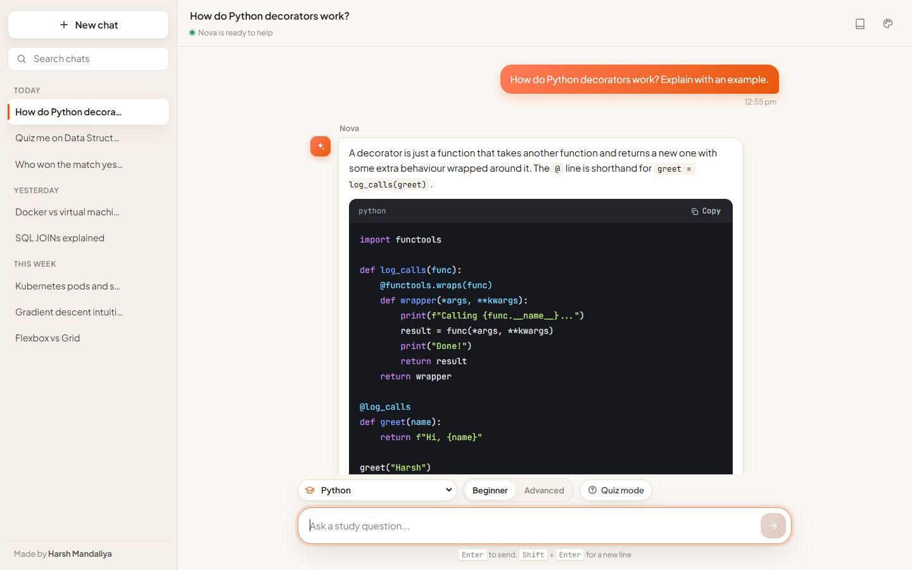
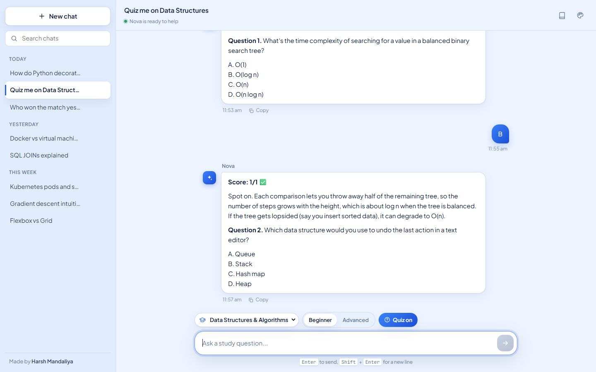
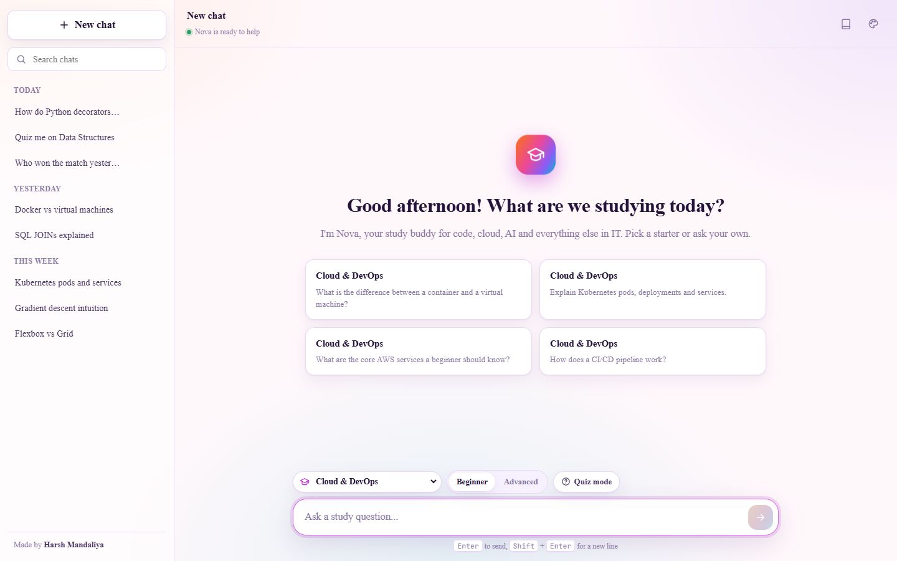
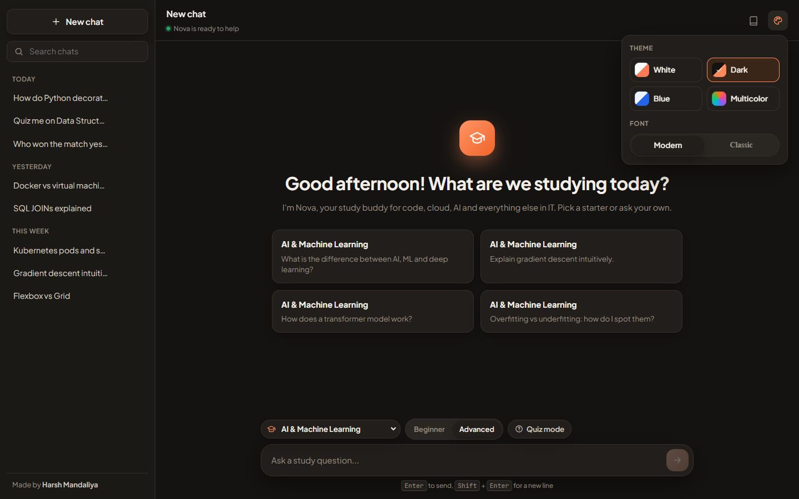
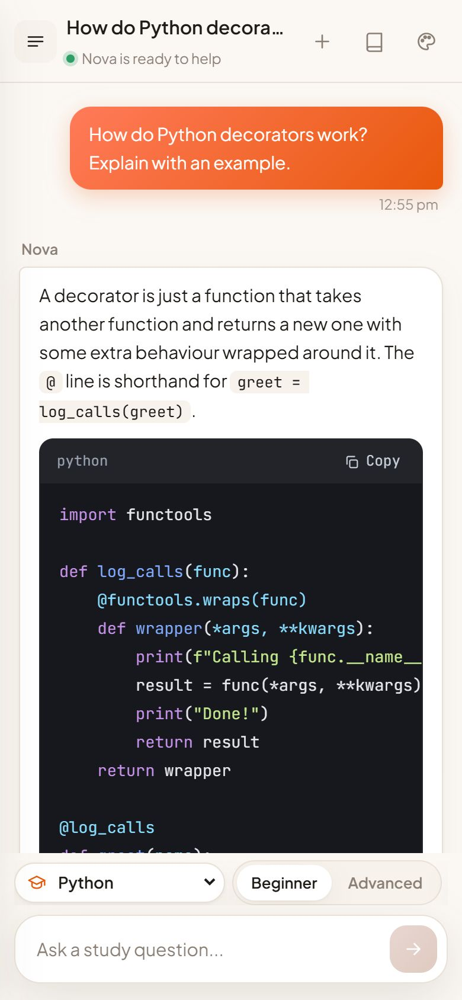

# AI Study Assistant for IT Engineers

A friendly study buddy for IT and engineering students. Ask about programming languages, web development, cloud, DevOps, AI and machine learning, data structures, databases, networking or system design, and get clear explanations with real code examples, streamed in as they're written.

The assistant (called **Nova** by default) only does study. Ask it about films or cricket scores and it will kindly steer you back to tech. It talks like a patient senior engineer: warm, direct and to the point, without the stiff "As an AI language model..." tone.

## Screenshots



| | |
|---|---|
|  |  |
| **Dark theme** with syntax-highlighted code | **Quiz mode** in the Blue theme, with a running score |
|  |  |
| **Multicolor theme** with the Classic (Times New Roman) font | **Theme and font menu**: White, Dark, Blue, Multicolor |
|  |  |
| **Welcome screen** with starter questions for the chosen subject | **Mobile layout** |

## Features

**Study tools**
- **Subject picker** with 11 areas: HTML & CSS, JavaScript & TypeScript, Python, Java/C/C++/Go and more, Data Structures & Algorithms, Databases & SQL, Cloud & DevOps (AWS, Azure, GCP, Docker, Kubernetes), AI & Machine Learning, Networking & Security, System Design, or all topics
- **Beginner / Advanced** switch that changes how deep and technical the explanations get
- **Quiz mode**: multiple-choice questions one at a time, with feedback and a running score
- **Starter questions** for every subject, so you're never staring at a blank box
- **Quick definitions** for any term, pulled from Wikipedia (free, no key needed)
- **Syntax-highlighted code blocks** with a one-click copy button
- **Study only**: off-topic questions get a friendly redirect back to tech

**Look and feel**
- Four themes: **White**, **Dark**, **Blue** and **Multicolor**
- Two fonts: **Modern** (sans-serif) and **Classic** (Times New Roman)
- Your theme, font, subject and level are remembered in the browser
- Replies stream in live, with a typing indicator, a stop button and retry on errors
- Saved chat history in a sidebar, grouped by day, with search, rename and delete
- Works well on phones: the sidebar becomes a slide-out drawer
- Smooth, subtle animations that respect "reduce motion"

**Backend**
- REST API built with FastAPI, plus a streaming endpoint using server-sent events
- Chats stored with SQLAlchemy (SQLite out of the box, Postgres if you want)
- Validation on every request, with clear error messages in one consistent shape
- Per-client rate limiting, so nobody can burn through your free quota
- Works with any OpenAI-compatible provider: **Google Gemini** (default), Groq, or a local Ollama
- A demo mode that runs without any API key, handy for trying the UI
- Secrets live in `.env`, which is never committed

## Tech stack

| Part      | Tools |
|-----------|-------|
| Frontend  | React 19, TypeScript, Vite, Framer Motion, react-markdown, highlight.js |
| Backend   | Python, FastAPI, SQLAlchemy, Pydantic, OpenAI Python SDK, httpx |
| Database  | SQLite (default) or PostgreSQL |
| AI model  | Google Gemini free tier by default; any OpenAI-compatible API works |
| Extras    | Wikipedia REST API for quick definitions |

## Free APIs used

| Service | What it's for | Cost | Key |
|---------|---------------|------|-----|
| [Google Gemini](https://aistudio.google.com/app/apikey) | The tutor's answers (default) | Free tier | Yes, free |
| [Groq](https://console.groq.com/keys) | Alternative model provider (Llama 3.3) | Free tier | Yes, free |
| [Ollama](https://ollama.com) | Run a model on your own machine | Free | No |
| [Wikipedia](https://en.wikipedia.org/api/rest_v1/) | Quick definitions | Free | No |

## Getting started

You'll need **Python 3.11+** and **Node.js 20+**.

### 1. Get a free Gemini key

1. Go to [Google AI Studio](https://aistudio.google.com/app/apikey) and sign in with a Google account.
2. Click **Create API key** and copy it.

That's it, no card needed. Prefer Groq? Grab a free key at [console.groq.com/keys](https://console.groq.com/keys) instead.

### 2. Backend

```bash
cd backend
python -m venv .venv
# Windows
.venv\Scripts\activate
# macOS / Linux
source .venv/bin/activate

pip install -r requirements.txt
cp .env.example .env      # then paste your key into LLM_API_KEY
uvicorn app.main:app --reload --port 8000
```

To use Groq instead of Gemini, change these lines in `backend/.env`:

```env
LLM_BASE_URL=https://api.groq.com/openai/v1
LLM_MODEL=llama-3.3-70b-versatile
```

Or run everything locally with [Ollama](https://ollama.com):

```env
LLM_BASE_URL=http://localhost:11434/v1
LLM_MODEL=llama3.2
```

Leave the key empty and the server starts in demo mode, so you can still click around.

### 3. Frontend

```bash
cd frontend
npm install
npm run dev
```

Open http://localhost:5173. Vite forwards `/api` requests to the backend on port 8000.

### Useful commands

| Command | What it does |
|---------|--------------|
| `npm run build` | Typecheck and build the frontend into `frontend/dist` |
| `npm run typecheck` | TypeScript check only |
| `npm run lint` | ESLint |
| `pip install -r requirements-dev.txt && pytest` | Run the backend tests (from `backend/`) |

## Configuration

All settings live in `backend/.env` (see `backend/.env.example`):

| Variable | Default | Purpose |
|----------|---------|---------|
| `LLM_BASE_URL` | Gemini | Any OpenAI-compatible endpoint |
| `LLM_API_KEY` | empty | Your provider key. Empty means demo mode |
| `LLM_MODEL` | `gemini-flash-latest` | Model name at your provider |
| `LLM_TEMPERATURE` | `0.7` | Higher is more playful, lower is more focused |
| `ASSISTANT_NAME` | `Nova` | What the tutor calls itself |
| `DATABASE_URL` | `sqlite:///./chat.db` | Where chats are stored |
| `CORS_ORIGINS` | `http://localhost:5173` | Allowed web origins |
| `RATE_LIMIT_PER_MINUTE` | `20` | Messages per client per minute |
| `MAX_HISTORY_MESSAGES` | `20` | How much of the chat the model sees |

Want to change the tutor's personality or the subject list? Edit `backend/app/persona.py` and `backend/app/subjects.py`.

## API

| Method | Route | Description |
|--------|-------|-------------|
| `GET` | `/api/health` | Server status, model name and demo flag |
| `GET` | `/api/subjects` | Study subjects with starter questions |
| `GET` | `/api/define?term=...` | A short definition from Wikipedia |
| `GET` | `/api/conversations` | List your chats, newest first |
| `POST` | `/api/conversations` | Start a new chat |
| `GET` | `/api/conversations/{id}` | A chat with all its messages |
| `PATCH` | `/api/conversations/{id}` | Rename a chat |
| `DELETE` | `/api/conversations/{id}` | Delete a chat |
| `POST` | `/api/conversations/{id}/messages` | Send a question and stream the answer. Body: `content`, plus optional `subject`, `level` (`beginner` / `advanced`) and `mode` (`chat` / `quiz`) |

Each browser sends a random `X-Client-Id` header that it keeps in local storage, so visitors only ever see their own chats. Interactive docs are at http://localhost:8000/docs while the server runs.

## Project structure

```
backend/
  app/
    main.py          app setup, CORS, error handling
    config.py        settings read from .env
    persona.py       the tutor's voice, levels and quiz mode
    subjects.py      study subjects and starter questions
    llm.py           streaming answers from the model provider
    rate_limit.py    sliding-window rate limiter
    models.py        Conversation and Message tables
    schemas.py       request and response validation
    routes/          chat, conversation and study endpoints
  tests/             API tests
frontend/
  src/
    App.tsx          layout and top bar
    hooks/useChat.ts chat state, streaming and history
    lib/             API client, themes and fonts
    components/      sidebar, messages, code blocks, study bar, menus
    styles.css       base design tokens (White and Dark)
    themes.css       Blue, Multicolor and the Classic font
    study.css        study bar, popovers and code highlighting
docs/screenshots/    images used in this README
```

## Author

**Harsh Mandaliya**
GitHub: [@Harsh-Mandaliya](https://github.com/Harsh-Mandaliya)

© 2026 Harsh Mandaliya. All rights reserved.
